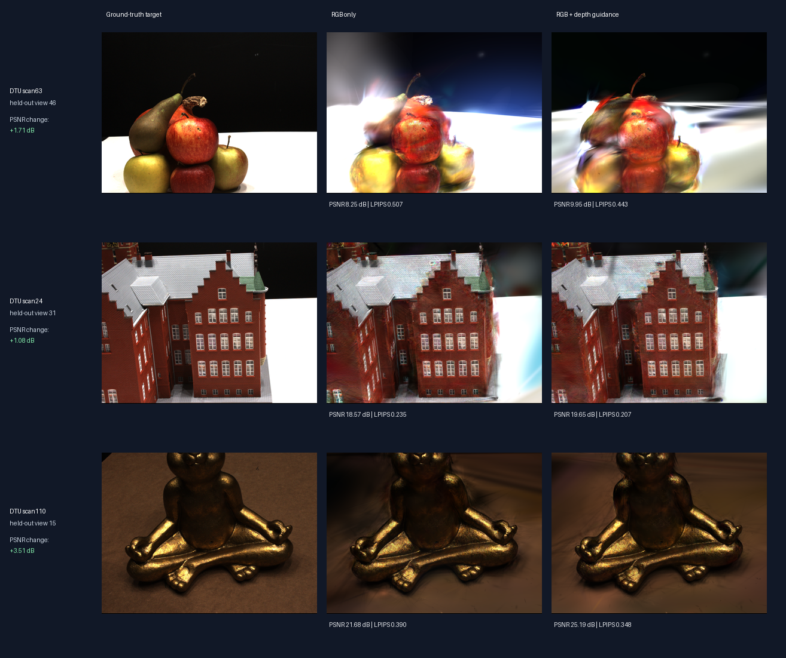

# Sparse-View 3D Gaussian Splatting

**Goal:** Implement the 3D Gaussian Splatting pipeline from scratch for learning purposes. Then, run a short
experiment to test whether monocular depth guidance can reduce overfitting when the model is trained from only a few camera views with aggressive densification.  

Datasets used are three [DTU](https://roboimagedata.compute.dtu.dk/) scenes: scan63, scan24, and scan110.

## Results

| Scene | Test PSNR | LPIPS | Depth AbsRel |
| --- | ---: | ---: | ---: |
| scan63 | **+1.617 +/- 0.467 dB** | **-0.0583 +/- 0.0130** | **-0.0123 +/- 0.0052** |
| scan24 | **+0.322 +/- 0.694 dB** | **-0.0049 +/- 0.0148** | **-0.0015 +/- 0.0006** |
| scan110 | **+1.267 +/- 1.348 dB** | **-0.0308 +/- 0.0111** | **-0.0036 +/- 0.0009** |

Across the nine comparisons, depth guidance reduced depth error every time. It also improved image quality in most runs: PSNR improved in eight of nine comparisons, while LPIPS improved in seven. Although depth guidance usually improves the overall image metrics, it doesn't improve every part of an image. For example, scan63 still shows noticeable stretching and smearing artifacts.

### Metrics

- **PSNR:** Pixel-level similarity to the target image; higher is better.
- **LPIPS:** Perceptual image difference; lower is better.
- **Depth AbsRel:** Average relative error between rendered and reference camera-space
  depth; lower is better. An AbsRel of `0.06` is roughly 6% relative depth error.
- **Train-test PSNR gap:** Difference between training-view and held-out-view quality;
  a large gap is evidence of overfitting.

### Conclusion

Aligned monocular depth
regularization consistently improves held-out sparse-depth accuracy and usually
improves novel-view appearance under sparse camera supervision, but does not yet
establish better complete-surface geometry.
